<p align="center">
  <picture>
    <source media="(prefers-color-scheme: dark)" srcset="imagenes/sarmia-oscuro.png">
    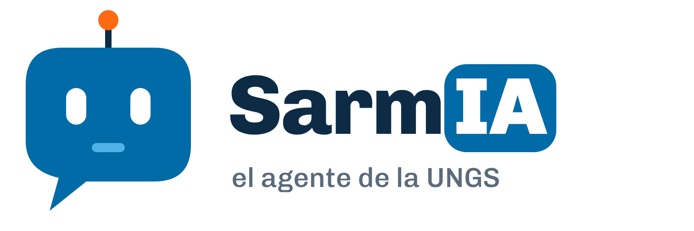
  </picture>
</p>

<p align="center"><b>Trabajo práctico de Introducción a la Programación · 2.º semestre 2026</b></p>

- El trabajo consiste en completar a **SarmIA**, un **agente conversacional de inteligencia artificial** construido con **[Google ADK](https://google.github.io/adk-docs/)**. Con SarmIA se conversa por chat para consultar la **oferta académica real de la UNGS del segundo semestre de 2026**: en qué día, horario y aula se dicta una materia, qué se dicta en un aula y si dos comisiones se superponen.

- Gran parte de la aplicación ya está resuelta: solo falta implementar las funcionalidades más importantes... ¿comenzamos? 😉.

### 📝 ¿Qué es un agente conversacional?

Un modelo de IA, como **Gemini**, es un programa que recibe texto y devuelve texto. No busca en una base de datos ni ejecuta nuestro código: a partir de lo que le escribimos, arma una respuesta.

En este TP, el modelo recibe la pregunta del usuario junto con dos cosas: unas **instrucciones** (cómo tiene que comportarse) y la lista de funciones de Python que puede pedir que se ejecuten, llamadas **herramientas**. Con eso decide qué herramienta conviene usar. **ADK** (*Agent Development Kit*, una biblioteca de Google) ejecuta esa función en la compu y le devuelve el resultado al modelo, que lo usa para redactar la respuesta. Un modelo que puede usar herramientas es un **agente**; si además se conversa con él por chat, es un **agente conversacional**.

**El modelo no conoce la oferta académica.** Las búsquedas, los filtros y los cálculos de horarios los programan ustedes: si una función tiene un error, SarmIA responde mal.

### 📝 ¿Cómo empiezo?

1. Descargá e instalá **Visual Studio Code** desde ```https://code.visualstudio.com/```
    - Adicionalmente, se recomienda la instalación de las siguientes extensiones para facilitar el desarrollo:
        - Pylance.
        - Python.
        - Python Debugger.

    Guía oficial de instalación de extensiones disponible [aquí](https://code.visualstudio.com/docs/editor/extension-marketplace).

2. Instalá Python **3.10 o superior** (recomendado: 3.12) desde ```www.python.org```. En **Linux** suele venir instalado; en Ubuntu y Debian hace falta además ```sudo apt install python3-venv```. **Asegurate de agregarlo al PATH durante la instalación:**


3. Creá una cuenta en GitHub [haciendo clic acá](https://github.com/signup?ref_cta=Sign+up&ref_loc=header+logged+out&ref_page=%2F&source=header-home). Luego, debés efectuar un *fork* (copia) del proyecto a tu repositorio (o al del grupo): [tutorial para hacer forks - thx. MitoCode](https://www.youtube.com/watch?v=9YUaf-uxuRM). **No te olvidés de mirar los clips de Git/GitHub al final de este documento**.

4. Cloná el repositorio copiado en tu máquina local (*git clone*) y abrí la carpeta en *VS Code*. Abrí una terminal desde el menú **Terminal > New Terminal**.
    - En Windows sirve PowerShell (la que abre VS Code por defecto) o CMD. Si al activar el entorno virtual PowerShell muestra que "la ejecución de scripts está deshabilitada", usá CMD: en la terminal de VS Code, flecha al lado del **+** y elegir **Command Prompt**.
    - Todos los comandos que siguen se escriben en esa terminal, parados en la carpeta del TP.

    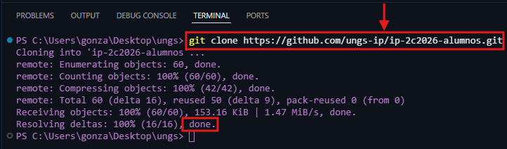

5. Creá el **entorno virtual** e instalá las dependencias. El entorno virtual es una carpeta (```.venv```) donde se instalan los paquetes del TP sin tocar el resto de la compu. Se crea una sola vez:

    | Windows | macOS y Linux |
    |---|---|
    | ```python -m venv .venv``` | ```python3 -m venv .venv``` |
    | ```.venv\Scripts\activate``` | ```source .venv/bin/activate``` |

    Al activarlo, la línea de la terminal empieza con ```(.venv)```. Después, en cualquier sistema:

    ```pip install -r requirements.txt```

    **Cada vez que se abre una terminal nueva hay que volver a activar el entorno** (la segunda línea de la tabla).

    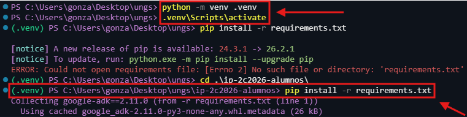

6. Creá la **clave de Gemini**. El agente necesita una clave **gratuita** para usar el modelo. Alcanza con una por grupo:
    - Entrar a [aistudio.google.com/apikey](https://aistudio.google.com/apikey) e iniciar sesión con una cuenta de Google.
    - La primera vez, aceptar los términos de uso.
    - Hacer clic en **Create API key** (en español, **Crear clave de API**). Si pide elegir un proyecto, elegir el que aparece por defecto.
    - Copiar la clave.

    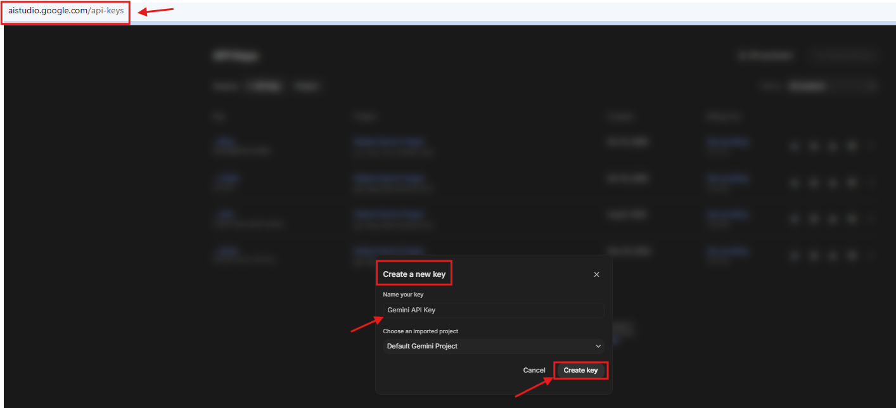

7. Guardá la clave ejecutando:
```python configurarClave.py```

    Pide la clave: se pega y se aprieta Enter. Queda guardada en ```sarmi/.env```. **Ese archivo no se comparte, no se sube a GitHub y no se entrega con el TP** (el repositorio ya está configurado para ignorarlo).

8. Verificá que todo esté bien instalado:
```python verificarEntorno.py```

    Tienen que aparecer cuatro líneas con ```[OK]```. Si alguna dice ```[FALLA]```, debajo indica qué hacer.

    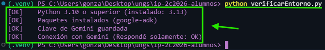

9. Corré los tests:
```python -m pytest```

    Al principio casi todos fallan: es lo esperado.

    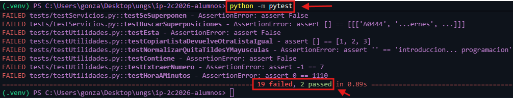

10. Levantá el agente:
```python -m google.adk.cli web```

    - La primera vez, la terminal pregunta ```Enable telemetry? [Y/n]```: escribir **n** y apretar Enter. Si en el navegador aparece el cartel **Help Improve ADK!**, hacer clic en **No Thanks**.
    - Abrí tu navegador y dirigíte a ```http://127.0.0.1:8000```. Elegí ```sarmi``` arriba a la izquierda y escribí, por ejemplo:
        - *Hola* (SarmIA se presenta)
        - *¿En qué aula es Introducción a la Programación?*
        - *¿Qué se dicta en el aula 7118 el viernes?*
        - *¿Se me superponen Introducción a la Programación comisión 7 y Análisis Numérico comisión 1?*
    - Para cerrar el agente, apretá **Ctrl+C** en la terminal.

    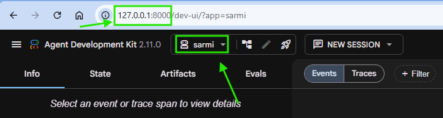

### 📝 Lo que ya está implementado

El proyecto está construido sobre una **[arquitectura multicapas](https://medium.com/@e0324913/multilayered-software-architecture-1eaa97b8f49e)**, donde cada capa posee una única responsabilidad, a saber:

- **Persistencia** (lee la oferta académica del archivo CSV).
- **Utilidades** (funciones generales sobre listas, textos y horas, que se reutilizan en todo el proyecto).
- **Servicios** (la lógica del problema: buscar materias, aulas, superposiciones y turnos, y armar las respuestas).
- **Herramientas** (las funciones que el modelo puede usar; solo llaman a los servicios).
- **Controles** (revisan la pregunta antes de que llegue al modelo).

```
sarmi/
├── agent.py                  Define el agente: modelo, instrucciones y herramientas
├── configuracion.py          Valores configurables
├── datos/oferta.csv          Oferta académica (un horario por fila)
└── capas/
    ├── persistencia/         repositorio.py
    ├── utilidades/           listas.py, textos.py, horas.py
    ├── servicios/            materias.py, aulas.py, superposiciones.py, turnos.py, consultas.py
    ├── herramientas/         herramientas.py
    └── controles/            controles.py
tests/                        Tests de las funciones
configurarClave.py            Guarda la clave de Gemini
verificarEntorno.py           Revisa que la instalación esté completa
```

- A nivel de **agente**, el archivo **agent.py** define a SarmIA: qué modelo usa, sus instrucciones y la lista de herramientas que puede usar. El archivo **configuracion.py** reúne todos los valores que se pueden cambiar sin tocar el código: el modelo, el saludo, las instrucciones, la posición de cada dato dentro de un horario, los turnos, etc.

- A nivel de **herramientas**, el archivo **herramientas.py** tiene las cuatro funciones que el modelo puede pedir que se ejecuten: *consultarMateria*, *consultarAula*, *consultarSuperposicion* y *consultarTurno*. Ojo: en estas funciones el **docstring** (el texto entre ```"""```) es obligatorio, porque ADK se lo manda al modelo para que sepa para qué sirve cada herramienta.

- A nivel de **datos**, el archivo **datos/oferta.csv** tiene los 1.572 horarios de la oferta académica que publica la UNGS. El archivo **repositorio.py** lo lee y lo devuelve como **lista de listas**.

- Se incluyen además el script **configurarClave.py** (guarda la clave), el script **verificarEntorno.py** (revisa la instalación) y los **tests** de las funciones obligatorias (carpeta ```tests```).

No se evalúa en qué capa ponen cada función nueva, pero se recomienda ubicarla en la que corresponde (ante la duda, consultar con los docentes).

Cada fila del CSV es un **horario**: un día de cursada de una comisión, con su hora y su aula. Una comisión que cursa dos días tiene dos horarios. Por ejemplo, Introducción a la Programación comisión 7 tiene dos: uno los viernes de 18:00 a 22:00 en el aula 7118 y otro virtual asincrónico.

Cada horario es una lista con 14 datos: código, materia, comisión, fecha de inicio, fecha de fin, día, hora de inicio, hora de fin, aula, edificio, tipo de cursada, instituto, instancia y comisión con la que se comparte. Por ejemplo:

```
["A0444", "INTRODUCCIÓN A LA PROGRAMACIÓN", "COM-07", "10/08/2026", "28/11/2026", "Viernes",
 "18:00", "22:00", "LABO COM 7118", "MODULO VII", "INFORMÁTICA", "Instituto de Ciencias",
 "Regularidad/Promoción", ""]
```

**Recorrido de una pregunta.** El diagrama se lee de arriba hacia abajo: cada flecha es un mensaje entre dos partes del programa. Las flechas rojas son los *requests* al modelo: cada pregunta del chat usa al menos dos.

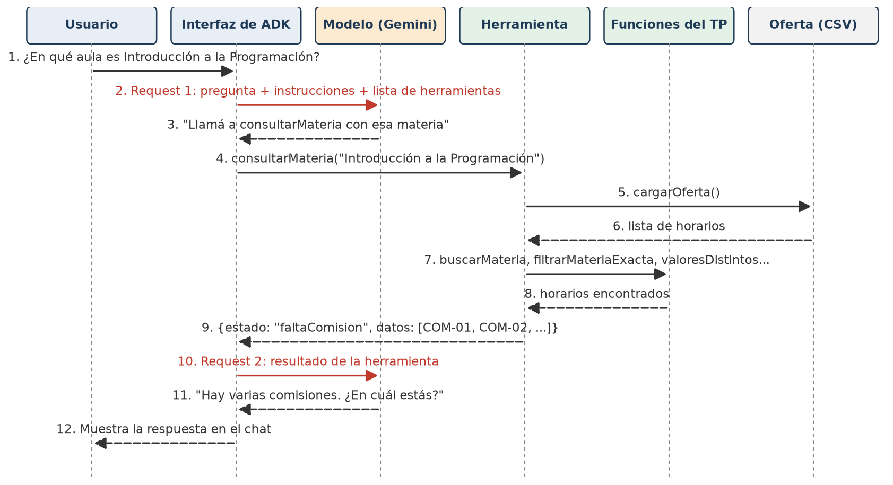

### 📝 ¿Qué voy a ver al iniciar la app?

- Al abrir ```http://127.0.0.1:8000``` y elegir ```sarmi```, verás el chat a la derecha y, a la izquierda, el panel de **eventos**: ahí se ve qué herramienta eligió el modelo, con qué datos la llamó y qué le devolvió. **Es la mejor forma de entender qué está pasando y de encontrar errores.**

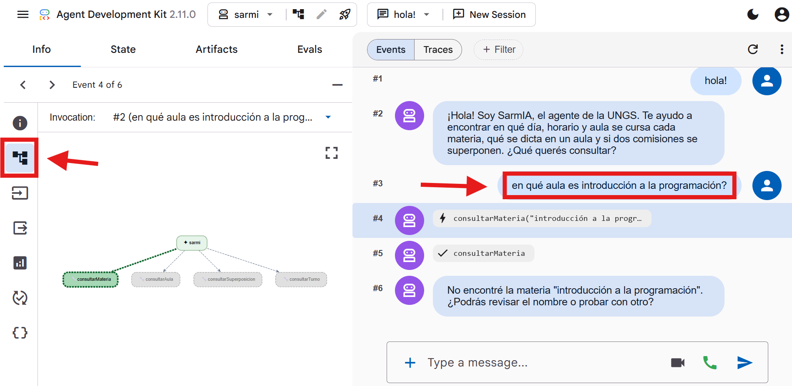

- Al hacer clic en un evento se ve el detalle de la llamada a la herramienta: el nombre, los datos con los que la llamó el modelo y la respuesta.

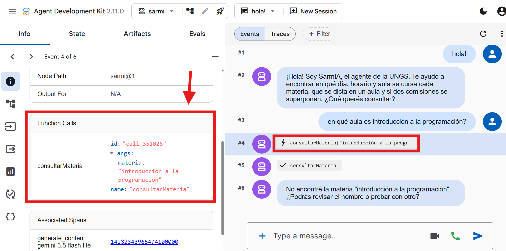

- Al principio, como las funciones obligatorias están vacías, SarmIA saluda bien pero responde que no encuentra ninguna materia.

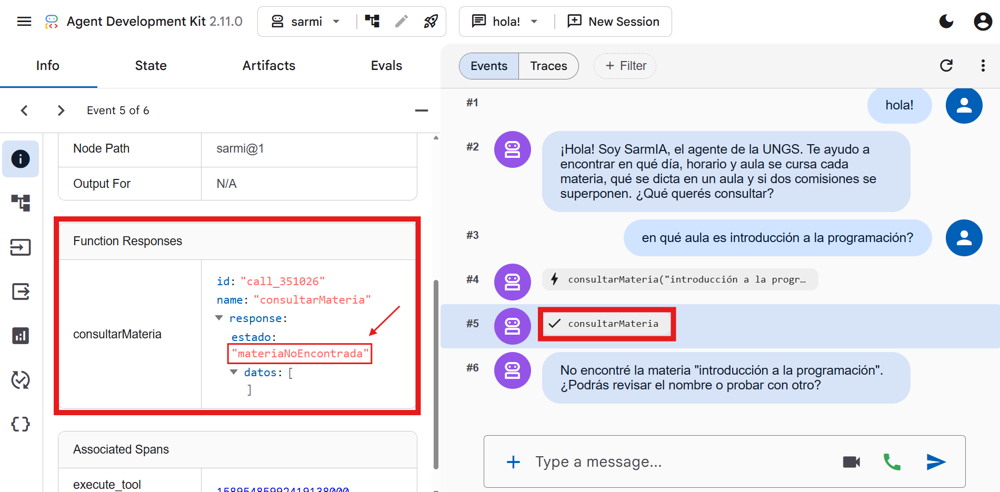

### 📝 Lo que falta hacer (OBLIGATORIO)

- Aún falta implementar ciertas funciones de las capas **utilidades** y **servicios**. Son las encargadas de que SarmIA encuentre los horarios. Se pueden agregar todas las funciones auxiliares que hagan falta. **En el código, cada función tiene un comentario que explica qué recibe, qué hace y qué devuelve, con un ejemplo.**

    - **(1) utilidades/listas.py**:
        - *esta(elemento, lista):* devuelve True si el elemento está en la lista.
        - *copiarLista(lista):* devuelve una lista nueva con los mismos elementos.

    - **(2) utilidades/textos.py**:
        - *normalizar(texto):* devuelve el texto en minúsculas y sin tildes, para que "Programación" y "programacion" se consideren iguales.
        - *contiene(texto, buscado):* devuelve True si *buscado* aparece en alguna parte de *texto*.
        - *extraerNumero(texto):* devuelve el número que aparece en el texto ("COM-07" → 7). Si no hay números, devuelve -1.

    - **(3) utilidades/horas.py**:
        - *horaAMinutos(hora):* convierte una hora "HH:MM" en minutos desde las 00:00 ("18:30" → 1110).

    - **(4) servicios/materias.py**:
        - *valoresDistintos(horarios, posicion):* los valores que tienen los horarios en una misma posición, sin repetir.
        - *buscarMateria(oferta, nombre):* los horarios cuya materia contiene el nombre buscado.
        - *filtrarMateriaExacta(horarios, nombre):* los horarios cuya materia se llama exactamente así.
        - *filtrarPorComision(horarios, comision):* los horarios de una comisión ("7", "07" y "COM-07" son la misma).

    - **(5) servicios/aulas.py**:
        - *horariosEnAula(oferta, aula, dia):* los horarios que se dictan en un aula un día.
        - *ordenarPorHora(horarios):* una lista **nueva** ordenada por hora de inicio, usando el método de **inserción** (sin *sorted*).

    - **(6) servicios/superposiciones.py**:
        - *seSuperponen(horarioA, horarioB):* True si los dos son presenciales, el mismo día y sus horas se cruzan.
        - *buscarSuperposiciones(horariosA, horariosB):* los pares de horarios que se superponen.

- **A medida que se completan las funciones, los tests pasan y SarmIA empieza a responder.**

**Concluido su desarrollo, deberían ver todos los tests en verde** (en su repositorio son 21; la imagen muestra 24 porque incluye tests de opcionales):

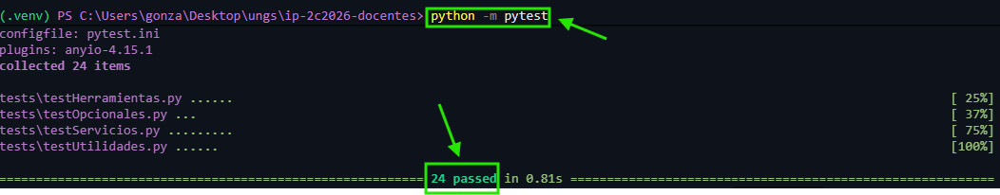

y SarmIA responde correctamente las preguntas de ejemplo del paso 10:

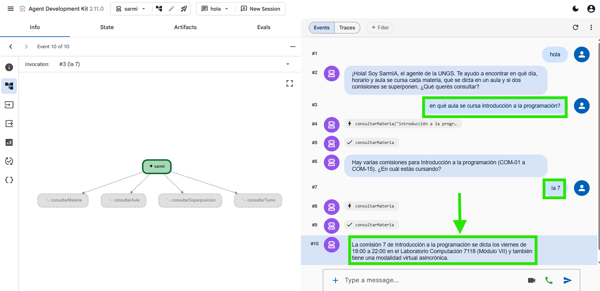

### 📝 Condiciones de entrega

- Requisitos de aprobación y criterios de corrección
    - El TP debe realizarse en grupos de 2 o 3 integrantes (no 1). Para aprobar el trabajo se deberán reunir los siguientes ítems:
      - **Todos los tests pasan y SarmIA responde las preguntas de ejemplo.**
      - El código debe ser **claro**. Las variables y funciones deben tener nombres que hagan fácil de entender el código a quien lo lea -de ser necesario, incluir comentarios que clarifiquen-. **Reutilizar el código mediante funciones todas las veces que se amerite.**
      - No debe haber variables que no se usan, funciones que tomen parámetros que no necesitan, ciclos innecesarios, etc.
    - **El 'correcto' funcionamiento del código NO es suficiente para la aprobación del TP, son necesarios todos los ítems anteriores.** Además, en la **defensa oral** cada integrante explica y modifica en el momento la parte que hizo.

### 📝 Opcionales
Las siguientes funcionalidades NO son necesarias para la aprobación (con nota mínima **4**), pero sirven para mejorar la calificación. De optar por hacerlas, se aplican las mismas reglas y criterios de corrección respecto de las funcionalidades básicas. Cualquier otra funcionalidad extra que se desee implementar debe ser antes consultada con los docentes.

**Los opcionales notados con ⭐ ya están parcialmente resueltos.** Se sugiere comenzar con ellos y luego seguir con los demás. **⚠️NO ES NECESARIO REALIZAR TODOS LOS OPCIONALES.⚠️** Enfóquense en los más relevantes, teniendo en cuenta el tiempo de desarrollo y pruebas.

- #### **Turno** ⭐ (dificultad baja)
  - Completar *turnoDe* y *filtrarPorTurno* en **servicios/turnos.py** para que SarmIA responda "¿qué comisiones de Álgebra hay de noche?". Los turnos están en **configuracion.py** y la herramienta *consultarTurno* ya está conectada.

---

- #### **Personalidad** ⭐ (dificultad baja)
  - SarmIA ya tiene nombre y saludo. Darle una personalidad propia (tono, forma de presentarse, cómo responde cuando no encuentra algo) cambiando ```SALUDO``` e ```INSTRUCCIONES_DEL_AGENTE``` en **configuracion.py**. Mostrar en el informe el antes y el después.

---

- #### **Límites del agente** ⭐ (dificultad baja)
  - Completar *esPreguntaPermitida* en **controles/controles.py** para que rechace preguntas con palabras no permitidas (lista ```PALABRAS_NO_PERMITIDAS``` en **configuracion.py**). La pregunta rechazada no llega al modelo, así que no gasta *requests*.

---

- #### **Respuestas con opciones** (dificultad media)
  - Cuando hay varias materias o comisiones, mostrarlas numeradas y aceptar que el usuario responda solo con el número.

---

- #### **Aulas libres** (dificultad media)
  - Dado un día, una franja horaria y un edificio, decir qué aulas están libres. Se sugiere reutilizar *seSuperponen*.

---

- #### **¿Quisiste decir...?** (dificultad media)
  - Si no encuentra la materia, sugerir las más parecidas (por palabras en común).

---

- #### **Mi semana** (dificultad media)
  - El usuario dice sus materias y comisiones, y SarmIA arma su horario semanal ordenado por día y hora.

---

- #### **Recordar mis materias** (dificultad media)
  - Que SarmIA guarde durante la conversación las materias que el usuario ya dijo.

---

- #### **Evaluar al agente** (dificultad media)
  - Armar diez preguntas con su respuesta esperada y guardarlas en la pestaña **Evals** de la interfaz de ADK, para volver a probarlas después de cada cambio.

    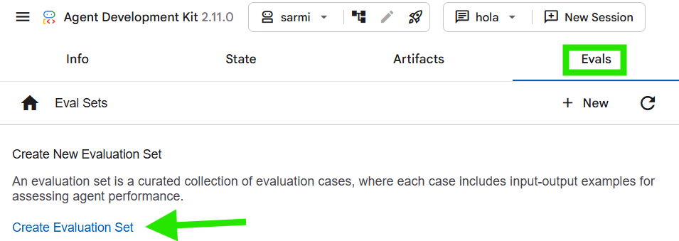

---

- #### **Inscripción sin choques** (dificultad alta)
  - Dadas tres o cuatro materias, proponer una combinación de comisiones que no se superponga.

---

- #### **Exportar a Google Calendar** (dificultad alta)
  - Generar un CSV con las clases de cada semana entre la fecha de inicio y la de fin, en el formato que Google Calendar permite importar.

---

- #### **Segundo agente** (dificultad alta)
  - Un agente de calendario académico (inscripciones, parciales, feriados) con su propio CSV, y SarmIA como agente principal que le pasa las preguntas que le corresponden.

---

### 📝 Plan gratuito de Gemini
- El TP viene configurado con un modelo **gratuito** que alcanza para hacerlo completo, opcionales incluidos. **Los tests no usan el modelo**: solo se gastan *requests* al conversar con SarmIA.
- El plan gratuito tiene un límite de *requests* por minuto (un *request* es cada mensaje que el agente le manda al modelo; cada pregunta del chat usa dos o más). Si aparece el error ```429 RESOURCE_EXHAUSTED```, esperar un minuto y volver a preguntar. Si aparece ```503 UNAVAILABLE```, el modelo está con mucha demanda: esperar y reintentar.

### 📝 Fecha de entrega
El trabajo debe ser entregado en la fecha estipulada en el cronograma. **Recordar que es requisito hacer pre-entregas.**

### 📝 Formato de entrega
- La entrega se divide en 2 partes: **código** e **informe**:

  - **Parte 1: código:** todo el desarrollo debe estar en un repositorio interno del grupo (*fork* del repo base del TP). Se debe agregar a los docentes de la comisión para que puedan seguir los avances (corregir funciones, dar sugerencias, etc.). Dado el caudal de alumnos, **los estudiantes son responsables de avisar a los docentes para revisar una pre-entrega o resolver cualquier duda que bloquee el avance del TP**.

    Sugerimos:
      - Que cada integrante tenga su propia cuenta de GitHub, NO usar una única en el proyecto.
      - Cada integrante debe *commitear* una o varias porciones de código, dependiendo cómo distribuyan el trabajo. **Se debe visualizar el aporte individual al TP.**
      - **Nunca subir el archivo ```.env``` con la clave.**

  - **Parte 2: informe:** deben redactar un documento donde exista una introducción que explique de qué se trata el trabajo (sin utilizar lenguaje técnico), que incluya el código de las funciones implementadas y una breve explicación de cada una de ellas junto con las **dificultades de implementación** y **decisiones tomadas** -con su correspondiente justificación-. **NO incluir explicaciones de funcionalidades de Python, ADK o similares**. Si usaron IA para programar, contar para qué la usaron y qué cambiaron de lo que propuso. Este documento debe estar en formato PDF anexo dentro de la carpeta del TP.

  🔥 **Se DEBE cumplir con ambas partes (código + informe) para aprobar el trabajo práctico.**

### 📝 Documentación adicional
- Documentación oficial de Google ADK disponible aquí: https://google.github.io/adk-docs/
- Cómo crear la clave de Gemini: https://ai.google.dev/gemini-api/docs/api-key
- Sección **GIT**
    - Introducción a GIT: [clic acá](https://www.youtube.com/watch?v=mzHWafbVRyU).
    - Manejo de ramas/branches: [clic acá](https://www.youtube.com/watch?v=BRY9gamL9PE).
    - Merge & resolución de conflictos: [clic acá](https://www.youtube.com/watch?v=9YUaf-uxuRM).
